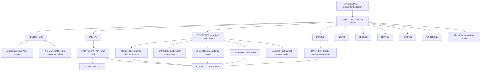

# Common MFD and UFC workflow

Implemented and installed 27 October 2026. All four main displays use the same format library and physical bezel layout. Each display retains its own format and data subpage. Changing master mode changes applicable sensor/weapon content without replacing the pilot's selected formats. The two upper UFDs keep their existing formats and controls.

The main displays use the upper UFDs' existing `ScreenColor = {3, 3, 3, 255}`. This is a dark neutral gray. Native screenshot samples have the same dominant `(10,10,10)` and `(11,11,11)` output pixels on the upper and main displays after DCS rendering. Instrument colors, including the attitude indicator's sky hemisphere, remain meaningful instrument colors.

## Navigation

| Control | Common location |
|---|---|
| MENU | PB13, bottom center |
| RTN | PB12, where a subpage or menu has a return destination |
| DATA | PB11, where the format has a data subpage |
| Range decrease / increase | PB15 / PB14 |

The old separate SMS, BAY, ATTACK, system-selector and legacy map routes are absent from the active menus. Stores includes the original bay illustration, inventory, programming access and door status in one format. Radar and DEF can each be selected on any main display. DEF range changes its own presentation without retasking radar range.

NAV retains WYPT PB6, TCN PB7, ILS PB8, WPDSG PB9 and UNDESG PB10. Heading entry is PB16; direct-to PB17; auto sequencing PB18; previous/next waypoint PB19/PB20. Data views provide the explicit OBS toggle for waypoint/TACAN course steering; entering a course alone does not enable OBS. Steering readouts have three spaced rows; course and cross-track detail are on waypoint DATA.

## Stores and numeric entry

With a ground munition selected, press **HUD PB8 on Stores**. Release quantity, multiplication and interval are presented in the UFC option area, not repeated on Stores. Only the selected delivery mode appears in the normal Stores view; alternatives appear in MODE. A/A `LOAD` and cannon `ROUNDS` are inventory counts, not release-program fields.

1. Press the option next to the field to edit.
2. Type with the UFC keypad. The draft appears in the separate window directly above the keys. Accepted option readouts stay unchanged.
3. Press the same option again to submit.

CLR clears the complete draft. UNDO removes one character. Option 5 is not a universal Enter key. A trailing `_` is the entry cursor; `02_` preserves both leading zeros and the string type required by DCS's text renderer. Invalid input retains the old program and editable draft with rejection feedback. Leaving programming, changing the selected store/profile, or losing power cancels the transaction.

UFC Stores fields: Option 1 quantity; Option 2 multiplication; Option 3 interval; Option 4 interval units. Option 5 remains blank because the backend does not provide verified fuze programming.

## UFC categories and autopilot

| Button/page | Contents |
|---|---|
| COM1 | Existing DCS communications menu |
| NAV | TACAN channel, ILS frequency, course, TACAN band/mode; rocker accesses reference/GPS/IRS setup |
| STPT | Waypoint ID, latitude, longitude, elevation; hemisphere modifier while entering coordinates |
| ALT | Barometric setting, MSL/AGL warning floors, pressure units, standard pressure |
| AP | ATTH, HSEL, BALT, RALT, NAV CPL; active modes marked with a colon |
| OTHR | Audio, kneeboard, ground services and ground-only cockpit preferences |
| IFF | Existing radar interrogation controls |

Opening AP does not engage it. BALT/RALT capture current altitude before commanding the existing flight-guidance owner. NAV CPL provides lateral route coupling; the selected altitude hold remains independent. It does not automatically follow waypoint altitude restrictions. Right-clicking the physical AP button disconnects AP and A/T.

The shipped cockpit model lacks named clickable anchors for the visible IFF and DVR keys. `ICP IFF` and `ICP DVR` bindings are added to both input profiles; the actual IFF page is accessible by binding. A second radio and DVR recording are unavailable, and HUD does not expose invented settings. These are implementation limits, not completed aircraft capabilities.

## Verification and installation

- All 36 format/display combinations passed actual in-game routing checks. A/G selection preserved all four format assignments.
- Native UFC checks passed: draft `02_`, UNDO `0_`, CLR, quantity change to two, rejection of an invalid quantity without altering the accepted value, correction, interval change to 500 ms, TACAN 16 and AP page opening without engagement.
- The first validation run exposed a native string-formatting crash on numeric-only scratchpad text. Its stack passed through `ceStringPoly::set_strcat_by_predefined_format` and `text_using_parameter`. The trailing cursor prevents numeric-string coercion; the corrected run completed both native suites without that crash. The offline UFC fixture now models native numeric-string coercion.
- Twelve selected regression scripts pass, including startup/power, radar weapon/ACM state, ground designation rejection, NAV designation, store release/actuators, vehicle indications and both new UI contracts. This is not a claim that every historical UI test or every aircraft capability was revalidated.
- Background samples match the upper UFDs. Existing HUD, upper-UFD and DLL hashes were unchanged by this installation. No radar backend or native flight-model DLL was built or replaced for this work.

Installed destination: `C:/Users/Ethans Desktop 2.0/Saved Games/DCS/Mods/aircraft/F-22A`.

Original replaced files are backed up under `D:/Codex-F22-Overhaul-2026-10-25/mfd-overhaul-20261027/installed-before/`. The installation receipt records all 66 affected files and their hashes. Temporary native testing hooks were removed after the completed test session.

Evidence: [native control results](resources/research/mfd-overhaul-2026-10-27/native-results.txt), [regression results](resources/research/mfd-overhaul-2026-10-27/regression-final-results.json), [installation receipt](resources/research/mfd-overhaul-2026-10-27/install-receipt.json), [native cockpit](resources/research/mfd-overhaul-2026-10-27/F22-MFD-layout.png), [native Stores keypad](resources/research/mfd-overhaul-2026-10-27/F22-MFD-stores-keypad.png). Offline previews in that directory verify layout only; they do not validate terrain imagery or sensor performance.
