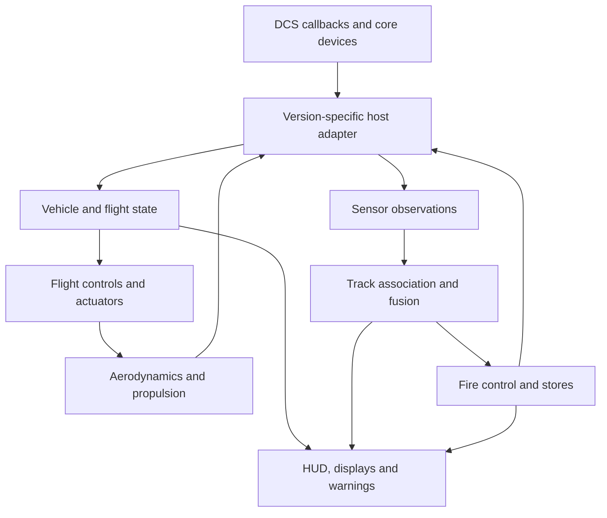

# Standalone avionics and flight-model design

## Installed standalone implementation — 25 October 2026

The current fork owns its cockpit, HUD, EFM, radar control/track files, weapons control, RWR, route navigation and countermeasure/ECM controls. `make_flyable` registers the local cockpit and `F22.dll`; no F-15C or Hornet cockpit is instantiated. **F-15C, Flaming Cliffs and Hornet aircraft modules are not prerequisites for the qualified configuration.** No preload change to another aircraft is required.

This independence was tested on **DCS 2.9.30.28738, Windows x64** by temporarily moving both installed paid aircraft directories (`F-15C` and `FA-18C`) outside the simulator tree before cold process starts. Per-flight loaded-module manifests reject `F15.dll`, `F15CCWS.dll` and `FA18C.dll`. Common DCS libraries (`CockpitBase`, `Weapons`, `WeaponsBase`, `World`) remain expected simulator dependencies. Core AI aircraft libraries with similar names are not player avionics dependencies. All temporarily moved directories are restored after testing; none of these filesystem operations are installation requirements.

### Native qualification

| Flight test with paid aircraft absent | Observed result |
| --- | --- |
| BORE acquisition and computed gun solution | Native STT and gun solution valid; actual cannon ammunition480 →423 after a burst |
| Countermeasures | Native chaff/flare quantities120/120 →119/119; repeated held private flare input plus release dispenses exactly one additional flare |
| ECM | Native activation requested; native flag false at the first0.3s observation, true at the next observation5s later; OFF command clears the actual flag. This verifies control/state, not jammer effectiveness or a real F-22 activation time. |
| Two-target TWS missile engagement | Two actual AMRAAM releases assigned to distinct native targets; both assigned targets receive native HIT events; native TOF service valid |
| Passive RWR | Eight surrounding native emitters received |
| Mission-route navigation and lifecycle | Actual route import, AUTO capture, waypoint/MFD/ICP controls and same-process restart reset |

The first isolated test exposed inherited countermeasure commands doing nothing and an ECM switch that only changed a cockpit variable. `EW_System.lua` now owns manual dispensing and native ECM requests/readback through `avSimpleWeaponSystem`. Master arm does not inhibit countermeasures. Physical bindings have explicit press/release edges; legacy global command pulses remain supported. Countermeasure indications use native quantities and empty state; ECM indication follows the actual native flag rather than the request. Power loss clears the request and commands native OFF. Native quantities are reread, including after service/rearm; a complete native ground-service rearm sequence is not qualified here.

Unused inherited HSI/ILS draw-argument readers were removed from the MFD owner. The route navigation producer is independent. Aircraft sensor names such as `AN/APG-63` in the shared AI database are retained where they identify an existing common model; renaming a database reference would not create AESA physics.

All **41 Python/Lua/asset checks and seven C++ CTests** pass locally. CI now loads real Git LFS assets and runs every self-contained Python test, rather than a stale short list. One old HUD/ADI test was updated to execute the actual shared-page wrapper after the MFD refactor; the instrument's rendering behavior was unchanged.

### Compatibility and remaining scope

The version-checked common native adapters were compiled and flown as DLL SHA256 `AD5648ACA8D85A3611577628A9C5E09C6C3E71B0EBD494C20F48E12A118CB218`. Source checkouts build their own DLL; proprietary DCS binaries and IDA databases are not bundled. A DCS update requires checking adapter readiness and repeating native qualification. This is a development build with a tested standalone core, not a claim that every subsystem is complete.

Remaining work includes multiplayer/server acceptance, full native ground-service rearm/respawn coverage, TACAN/ILS and approaches, independent cockpit radio tuning, advanced datalink, additional A/G store qualification, VR alignment/readability and RF jammer-effectiveness tests. Native look-down Doppler-notch/confirmation limits remain. The original model assets, source attribution and licences are retained.

## Historical architecture proposal — 24 October 2026

Proposed design, 24 October 2026. This is an implementation architecture and feasibility plan, not a claim that these replacement systems already run. See the [baseline assessment](OVERHAUL_ASSESSMENT.md) for source findings and the [roadmap](OVERHAUL_ROADMAP.md) for completion gates.

## Feasibility by subsystem

| Replacement | Assessment | Main remaining dependency or uncertainty |
| --- | --- | --- |
| EFM and thrust vectoring | Already independent source; substantial corrections/refactoring needed. | DCS force/mass/suspension callback contracts and flight calibration. |
| Custom HUD and head-down displays | Strong implementation precedent; feasible. | Cockpit connectors, angular projection, VR/export behavior and our display logic. |
| Engine, fuel, electrical, hydraulics, ECS and warnings | Feasible as our own simulation. | Public data supports different fidelity levels; host electrical device must agree with modeled buses. |
| Navigation, routes and autopilot | Feasible application logic. | Supported mission-route/beacon access, terrain/ILS integration and validated control-loop behavior. |
| Stores, gun, IR missile, countermeasures | Core devices and community precedents support a replacement path. | Prove launch, seeker behavior, stations, doors and multiplayer on the selected DCS build. |
| Radar search and single-target lock | Credible prototype path through `avSimpleRadar`. | Community documentation is not a stable ED SDK guarantee; basic behavior and limitations need reproduction. |
| Modern multi-track radar engagement | Highest uncertainty. | Basic device documentation explicitly lacks TWS. Custom tracks do not automatically become host missile-support tracks. |
| EW/fusion | Our own association/presentation logic is feasible. | Actual accessible host observations, emission effects and countermeasure effectiveness limit fidelity. |
| Native datalink/gateway integration | Conditional and scope-dependent. | Do not assume our track store can inject tracks into paid aircraft or implement native IFDL/MADL. |

### Implementation evidence

The checked-in [EFM API declarations](../EFM/include/FM/wHumanCustomPhysicsAPI.h) expose force, moment, mass, fuel, state and event callbacks. They establish what this repo is written against, not every capability of the current DCS engine.

[Community A-4E-C](RESOURCES.md#r87), inspected at [`34c1ef439581234ee24d4bde2e13a54999ebaa5a`](https://github.com/Community-A-4E/community-a4e-c/tree/34c1ef439581234ee24d4bde2e13a54999ebaa5a), uses `make_flyable`, `avSimpleWeaponSystem`, `avSimpleElectricSystem`, `avSimpleRWR`, radio/intercom devices and custom C++ avionics/radar components. Its tree also contains compiled avionics components. This is useful architectural precedent, **not proof that all implementation source or an unrestricted reusable library is provided**, and not proof of modern air-to-air TWS support. Study the design without copying permission-restricted code/assets.

[A-29B](RESOURCES.md#r152), inspected at [`1f632f004e28ef13a5f3404528de4c3fc982a0e2`](https://github.com/luizrenault/a-29b-community/tree/1f632f004e28ef13a5f3404528de4c3fc982a0e2), declares its own HUD, navigation, systems and `avSimplest*` devices. Its tree includes `avSimplest.dll` and `avSimplestRadio.dll`; these are not C++ source implementations we can simply recreate from their Lua callers. The author's README sets separate conditions for Lua reuse and C++ reuse on request. No code or binaries were imported for this assessment.

The [community radar documentation](RESOURCES.md#r148) describes RWS/STT, a powered `avSimpleElectricSystem` prerequisite, return/lock parameters and loss of other contact data in STT. The [weapon-device documentation](RESOURCES.md#r149) describes inventory, station launch, jettison, countermeasures and ECM controls; some functions are explicitly unverified. A [first-person modder report](RESOURCES.md#r150) reports radar-guided missile support with the simple device, plus close-range/lock and radio integration difficulties. These are leads for experiments, not proof of full F-22 functionality on our target version.

The [May 2025 ED forum exchange](RESOURCES.md#r151) records FC avionics preload/IC problems and an ED response declining the proposed change at that time. Removing this particular preload workaround is a useful goal, but does **not** guarantee that every server will accept an unofficial mod. Server policy, installed client/server content and current integrity checking must be tested normally.

## Own the aircraft, keep DCS behind an adapter

This is our proposed software structure; it does not assert that the real aircraft runs these particular classes or algorithms.

### State and ownership

Use one aircraft-state object for dynamic quantities instead of scattered globals and draw arguments as the system database. Keep the DCS entry points stable while extracting modules. C++ is a suitable owner for flight dynamics, engines, fuel, actuators and time-critical control loops. Lua can own cockpit interaction and presentation; mission logic may start in Lua where host device access requires it. The important constraint is **one writer per authoritative state**, not one mandatory language for everything.

Every exchanged field needs a name, unit, coordinate frame, timestamp, validity and producer. Use SI/radians internally, with explicit conversions at display and host boundaries. Keep body X-forward/Y-up/Z-right and roll/yaw/pitch ordering consistent with the existing EFM conventions. Navigation/world coordinates must have explicit transforms. Distinguish TAS, indicated/calibrated airspeed, Mach and ground speed; distinguish MSL, AGL, pressure altitude and radar height. Retain normal acceleration and body inertial acceleration as distinct quantities until the host's convention is verified.

Publish coherent snapshots to displays. Queue commands/events separately from measured state. Animation and synoptics consume actual actuator/door positions rather than drive them. Display refresh rates can be slower than physics; rate limits and filters use elapsed simulation time. Reset all per-aircraft state, including pending mass changes, static animation values and one-shot flags, at the appropriate lifecycle boundaries.

The adapter translates core device station numbering and units; it exposes capability flags when a function is unavailable. A missing interface must be an explicit limitation rather than a silent fallback to omniscient world data. Keep any legacy F-15 adapter separate during migration, and remove it from the standalone release dependency graph only after the acceptance gates pass.

### Vehicle systems

Start with engines, fuel supply, electrical buses and WOW because every other system consumes them. Add bounded tank quantities, capacities, locations, transfer/feed state and a conservation ledger using the host mass contract. Distinguish engine spool speed, delivered thrust, nozzle area, vector angle, fuel flow and displayed temperatures. Failures should propagate from the owning system: an engine can windmill without generating electrical power, a bus can fail with an engine running, and an indicator can fail without changing the underlying force model.

Model hydraulics and actuators sufficiently to make loss of authority, surface rate and synoptics agree. Add ECS/cabin pressure, oxygen and warning logic at an explicitly documented approximation level. Public information does not justify claiming a complete reproduced plumbing or FADEC schedule.

### Flight-control and force pipeline

Process each step in a documented order: host state/commands; air data and contact state; vehicle/engine supply; pilot command and mode logic; limiters; control allocation; physical actuators; aerodynamic and propulsive forces; host output and cockpit snapshot. Resolve coupling with bounded substeps or an explicit lag where necessary.

Pilot commands should request handling response, not simply surface deflection. Develop cruise, approach/landing and refueling behavior with smooth transitions and command shaping. Use measured response targets and anti-windup/rate-saturation handling. Do not transplant prototype PIO-era laws or invented production gains. [R20](RESOURCES.md#r20) is particularly valuable for the distinction between prototype and F-22 transition behavior and for evaluating demanding pilot tasks.

Represent each nozzle's state independently even if the first allocator commands both equally. For a pitch-only nozzle, resolve net installed thrust into body axes consistently as `Fx = T*cos(theta)`, `Fy = T*sin(theta)`, `Fz = 0`, subject to verified sign conventions and separately modeled losses. Compute the moment using the actual engine position relative to CG. Two pitch-vectoring nozzles are not individual yaw-vectoring nozzles. Any roll authority from differential vertical thrust must come from those forces and moment arms, not an invented lateral jet force.

Historical surface bounds from [R126, Fig. 9-12](RESOURCES.md#r126) provide an initial reference: LEF 30°/s, aileron/flaperon 70°/s, rudder 80°/s, horizontal tail 60°/s and nozzle 40°/s. These are labeled **no-load** and must not be treated as measured rates across the entire envelope. Hardware travel, scheduled command limits and loaded rate limits are separate concepts.

Build a coefficient model with declared conventions for all six force/moment coefficients, reference area/span/chord, alpha/beta/Mach effects, control derivatives and nondimensional angular rates. Include external-store/door/configuration effects consistently. Near-zero speed, high alpha/beta, reversed flow and ground contact need bounded behavior. Fit thrust and drag together against multiple conditions; matching a single top-speed figure cannot identify either model uniquely. Keep uncertain coefficients and calibrated values traceable to their source or assumption.

### Sensors, fusion and weapons

Define three layers: host observations; our radar/EW approximation and track association; fire-control decisions. Each observation retains its source and uncertainty. Track files need stable local IDs, age, estimated state, covariance/confidence, identity status and contributors. Device return-slot numbers are not guaranteed persistent aircraft identities.

Use only data actually accessible through the selected supported/core-device path. Do not design the cockpit around `LoGetWorldObjects`, mission-global object enumeration or an external export feed unless that dependency is explicitly chosen, permitted and documented. Those are different execution contexts and can expose information unavailable to aircraft sensors. A passive bearing-only observation must not silently acquire exact range, altitude or identity from simulator truth.

An initial `avSimpleRadar` adapter can provide an engineering prototype, but it has a different capability ceiling from an AESA. Application-side memory tracks may improve presentation; they do not prove simultaneous host-supported engagements. Do not advertise TWS solely because multiple symbols persist on screen after a scan or during STT.

For stores, separate selection, readiness and launch: inventory/station identity; master-arm and WOW permission; power and cooling/readiness approximation; door opening and ejector readiness; valid track/seeker state; release; confirmation; close/retry/failure. IR seeker lock, uncaged tracking and radar handoff are distinct states. The DCS adapter performs actual host weapon launch; our HUD consumes the same weapon solution the release logic uses.

RWR/ECM approximation should consume actual available host observations and controls, with disclosed omissions. Datalink must record source, age, affiliation confidence and network compatibility. [R108](RESOURCES.md#r108) is evidence for a gateway demonstration, not a reason to give the baseline direct universal F-22/F-35 communications.

## The decisive standalone experiment

Create a minimal development variant, installed only under Saved Games, with independent registration, the existing EFM, explicit electric/weapon/radar/radio devices and a simple debug presentation. This is an engineering experiment, not a distributable finished overhaul. Use a fresh DCS process/profile with F-15C/FC packages uninstalled or disabled and no other mod preloading their binaries. Record exact DCS build, installed modules and logs.

| Gate | Evidence required |
| --- | --- |
| Boot and ownership | Cold/hot/air start works; DLL loads; independent HUD and controls function; no F-15 preload or base-install edit. |
| Core devices | Power loss/recovery affects sensors correctly; ATC/AI radio menu and audio work; gun/IR missile/jettison/countermeasures work. Test native voice and SRS separately if offered. |
| Search and lock | Detect/lose a target through range, scan volume, aspect and terrain tests; record close-range and rear-aspect limitations; verify IFF distinction rather than assuming unknown equals hostile. |
| Guided engagement | Native radar lock produces a usable host-guided AIM-120 engagement, including a maneuvering target and support termination. Distinguish a supported shot from autonomous seeker acquisition after an unguided launch. |
| Multiple targets | Explicitly test concurrent track maintenance and missile support against two separated maneuvering targets. If it fails, release scope must state STT-only or another observed limitation. |
| Opponent behavior | AI/client RWR indications, emission control and countermeasure response correspond to actual host behavior, not just our cockpit symbology. |
| Network and lifecycle | Repeat with human client, dedicated server, respawn, late join, rearm and repair; document IC/server requirements. |

If basic search/STT and supported missiles pass but concurrent support fails, an independent limited-radar mod remains possible. A modern multi-target release then requires a different proven host integration path or an agreed limitation. If guidance cannot be implemented through an available compatible interface, keep the legacy combat variant while pursuing that integration separately. **Do not postpone discovering this constraint until after rebuilding every display.**

## Source and asset reuse

Preserve the project's GPL notices and the MIT notices on inherited template components. Do not reinterpret `EFM/LICENSE` as blanket permission to remove GPL notices from the actual RAPTOR implementation. Existing public EDMs/textures can be retained under their applicable terms; editable 3D authoring projects are largely absent from this tree, so geometry/connector changes may need new source assets. Publicly viewable third-party code or aircraft imagery is not automatically licensed for redistribution. Link research and use our own implementation rather than bundling papers or copying another mod's restricted components.
